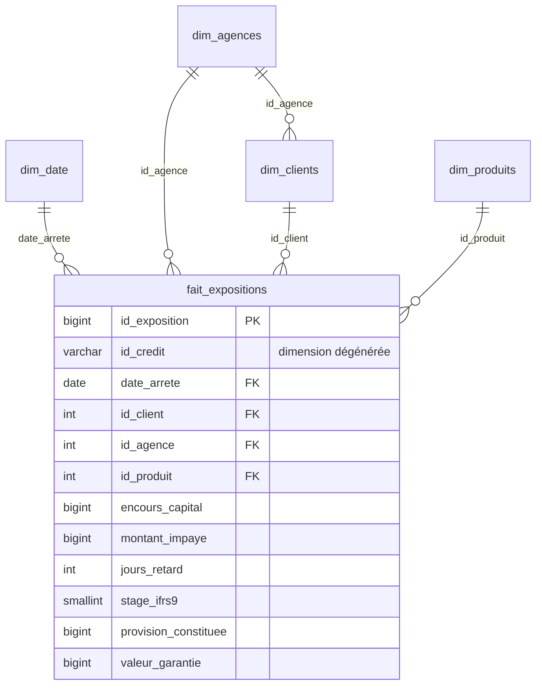

# 🏦 Pilotage du risque de crédit – BECC (zone CEMAC)
# Projet BI de bout en bout : PostgreSQL · Power BI · DAX · modélisation en étoile

> **Projet de portfolio.** BECC (*Banque Équatoriale du Crédit et du Commerce*) est une **banque fictive** ; toutes les données sont **synthétiques**, générées par un script reproductible, et ne représentent aucune institution réelle. Les chiffres cités ci-dessous proviennent du jeu de données fourni dans `data/`.

---

# 1. Contexte métier

**BECC** est une banque universelle fictive de taille moyenne, présente dans les **6 pays de la CEMAC** : Cameroun, Gabon, Congo, Tchad, République centrafricaine et Guinée équatoriale. Elle exploite **40 agences** dans 17 villes et opère en **franc CFA (XAF)**.

**Activités**
- **Banque de détail** : crédits de consommation, immobilier, véhicule, avances sur salaire.
- **PME** : crédits de trésorerie, d'investissement, crédit-bail, financement de campagne agricole, escompte commercial.
- **Entreprises et institutions** : financement de projets (pétrole, énergie, infrastructures), lignes revolving, **préfinancement de marchés publics**.

**Enjeux business**
- Contenir le coût du risque dans des économies exposées aux cycles du pétrole, aux retards de paiement de l'État et aux chocs de liquidité.
- Respecter les exigences prudentielles de la région (classification des créances, provisionnement, division des risques).
- Piloter un portefeuille réparti sur 6 pays aux profils très différents.

**Problèmes que la Direction et le Comité de risques veulent résoudre**
1. Les créances en souffrance (NPL) ont fortement augmenté en 2024 : **où et pourquoi ?**
2. Quels **pays, villes, agences, secteurs et produits** concentrent le risque ?
3. Les **provisions** (IFRS 9 / règles locales) sont-elles suffisantes face aux pertes attendues ?
4. La **concentration** sur certains clients et groupes économiques dépasse-t-elle les limites internes et réglementaires ?
5. Les **garanties** couvrent-elles réellement les créances douteuses, et les recouvrements sont-ils efficaces ?
6. Comment **détecter tôt** les dossiers qui se dégradent (migration entre stages) ?

# 2. Objectifs du projet
- Construire un **entrepôt analytique** PostgreSQL (schéma en étoile) sur 3 ans (2023-2025).
- Fournir des **vues SQL agrégées** (CTE, fonctions de fenêtrage) prêtes pour Power BI.
- Développer un **modèle sémantique** avec mesures DAX de risque (NPL, couverture, coût du risque, concentration).
- Livrer **4 dashboards** pour la Direction, le Comité de risques, les directeurs régionaux et les chefs d'agence, avec sécurité au niveau des lignes.

# 3. Architecture et modélisation

```
 CSV synthétiques ──► PostgreSQL (schéma risque) ──► vues agrégées ──► Power BI (modèle en étoile, DAX, RLS)
```



**Grain du fait** : 1 ligne = 1 crédit × 1 arrêté mensuel (fin de mois). Table de faits de type *snapshot périodique* : 13 722 lignes, 738 crédits, 36 arrêtés.

**Bonnes pratiques appliquées**
- **Un fait, un grain** : jamais de mélange mensuel / annuel dans la même table.
- **Clés de substitution entières** sur les dimensions ; `id_credit` conservé comme dimension dégénérée.
- **Mesures additives dans le fait** (encours, impayés, provisions) ; les ratios (taux NPL, couverture) sont calculés **en DAX**, jamais stockés.
- **Stocks vs flux** : les encours sont semi-additifs (dernier arrêté de la période), les recouvrements et passages en perte sont additifs.
- **Dimension date complète** et marquée comme table de dates ; relations 1→\* à sens unique.
- **Hiérarchies** explicites : pays > région > ville > agence ; année > trimestre > mois.
- Contraintes `PRIMARY KEY`, `FOREIGN KEY`, `CHECK` et index sur les clés de jointure.
- Colonnes techniques masquées dans Power BI ; mesures regroupées dans une table `_Mesures`.

# 4. Données (dossier `data/`)

| Table | Lignes | Rôle |
|---|---|---|
| `dim_date` | 1 096 | Calendrier quotidien 2023-2025 : `date_complet`, `annee`, `mois`, `jours`, `trimestre` |
| `dim_agences` | 40 | Pays, région, ville, agence, coordonnées GPS |
| `dim_clients` | 550 | Type, segment, secteur, groupe économique, note interne |
| `dim_produits` | 12 | Catégorie, garantie type, durées, taux, LGD de référence |
| `fait_expositions` | 13 722 | Expositions mensuelles par crédit |

**Dictionnaire du fait (extraits)**

| Colonne | Description |
|---|---|
| `encours_capital` | Capital restant dû en XAF à la fin du mois |
| `montant_impaye` | Échéances impayées cumulées |
| `jours_retard` | Ancienneté du plus ancien impayé |
| `statut_creance` | Sain, Restructuré, Impayé récent, À surveiller, Douteux, Litigieux |
| `stage_ifrs9` | 1 (< 30 j), 2 (30-89 j ou restructuré), 3 (≥ 90 j = NPL) |
| `note_risque` | Note interne A (meilleure) à E |
| `probabilite_defaut_pct`, `lgd_pct`, `exposition_ead` | Paramètres de risque |
| `perte_attendue` | PD × LGD × EAD |
| `provision_constituee` | Stage 1 : perte attendue 12 mois ; stage 2 : perte attendue élargie ; stage 3 : couverture de 45 % à 90 % selon l'ancienneté |
| `valeur_garantie`, `garantie_saisie` | Valeur de la sûreté ; 1 si réalisation engagée |
| `montant_recouvre`, `montant_passe_en_perte` | Flux du mois |

**Réalisme intégré** : trajectoires de retard mois par mois (impayé → douteux → litigieux), guérisons et restructurations, saisonnalité agricole, choc 2024 (pétrole, arriérés de l'État sur les marchés publics), primes de risque par pays et par secteur, groupes économiques à expositions croisées.

## 5. Structure du dépôt

```
projet_risques_bancaires/
├── data/        dim_date.csv · dim_agences.csv · dim_clients.csv · dim_produits.csv · fait_expositions.csv
├── sql/         01_schema_et_import.sql · 02_vues_power_bi.sql
├── docs/        MESURES_DAX.md · README_DASHBOARDS.md
└── README.md
```

# 6. Installation

Puis ouvrir Power BI Desktop, se connecter à PostgreSQL (mode Importer), créer les relations et coller les mesures de `docs/MESURES_DAX.md`. Le guide pas à pas des pages est dans `docs/README_DASHBOARDS.md`.

# 7. Techniques SQL mises en avant

| Vue | Objectif | Techniques |
|---|---|---|
| `vw_synthese_mensuelle` | KPI par pays et total groupe | `GROUPING SETS`, CTE chaînées, `LAG`, moyenne glissante, `RANK`, cumul annuel |
| `vw_synthese_trimestrielle` / `_annuelle` | Stocks de fin de période + flux | CTE, `LAG` QoQ / YoY |
| `vw_classement_agences` | Classement et priorisation | `RANK`, `DENSE_RANK`, `NTILE`, Pareto cumulé |
| `vw_top_clients_endettes` | Top 50 débiteurs | `ROW_NUMBER`, part cumulée |
| `vw_grands_risques` | Concentration vs fonds propres | `CROSS JOIN` paramètres, `STRING_AGG`, fenêtres |
| `vw_migration_stage` | Matrice de transition | `LAG` par crédit, `SUM(COUNT(*)) OVER` |
| `vw_garanties_recouvrements` | Garanties et recouvrements | `FILTER`, cumuls par fenêtre |
| `vw_cohortes_octroi` | Vintages | `DATE_TRUNC`, `LAG`, `MAX OVER` |
| `vw_alertes_creances` | Liste d'alertes | CTE, `LAG(…, 3)`, rangs |

# 8. Principaux enseignements (jeu de données fourni)

| Indicateur | 31/12/2023 | 31/12/2024 | 31/12/2025 |
|---|---|---|---|
| Encours (Md XAF) | 144,9 | 175,9 | 181,0 |
| Taux NPL | 6,6 % | **16,0 %** | 8,4 % |
| Couverture des NPL | 74 % | 71 % | 72 % |
| Part des créances en stage 2 | 14,6 % | 13,7 % | **18,3 %** |
| Perte attendue (Md XAF) | 7,6 | 15,7 | 9,9 |

- **Pic de risque au T4 2024** (NPL à 16,0 %), puis amélioration en 2025 portée en partie par **5,9 Md XAF de passages en perte** (contre 0,7 Md en 2024) et 3,8 Md XAF de recouvrements.
- **Pays** (31/12/2025) : RCA 27,3 % de NPL (19,3 Md d'encours), Tchad 15,1 % (37,7 Md), Gabon 4,2 %, Cameroun 4,2 % (62,4 Md), Congo 2,4 %, Guinée équatoriale 1,6 %.
- **Villes et agences** : Bangui (46,1 % de NPL) et N'Djamena (17,0 %) concentrent environ 11,0 des 15,3 Md XAF de créances en souffrance (≈ 72 %) ; les agences Bangui Plateau (53,3 %) et N'Djamena Plateau (25,6 %) sont les plus exposées.
- **Secteurs** (en montant de NPL) : commerce et distribution 5,6 Md (19,0 % de l'encours du secteur), télécommunications et IT 4,2 Md (30,5 %), pétrole, gaz et services 2,1 Md (74,4 % sur un encours de 2,9 Md).
- **Produits** : le financement de projets porte 9,5 Md XAF de NPL (9,2 % de son encours de 104 Md) ; le crédit de trésorerie affiche 43,5 % de NPL sur un petit encours (3,1 Md).
- **Concentration** (fonds propres de référence 30 Md XAF) : 22 bénéficiaires dépassent 10 % ; **2 groupes dépassent 45 %** (Ogooué Energies 49,0 %, Mayombe Invest 48,8 %) ; les 10 premiers bénéficiaires représentent 51,3 % de l'encours.
- **Garanties** : la valeur des sûretés couvre **149 %** de l'encours NPL, mais 42 garanties seulement sont en cours de réalisation : la récupération est plus lente que la couverture théorique.

# 9. Recommandations de décision
1. **RCA et Tchad** : geler les nouvelles autorisations sur Bangui Plateau et N'Djamena Plateau, créer une cellule de recouvrement dédiée et renforcer les contrôles à l'octroi.
2. **Concentration** : ramener les deux groupes proches de 49 % sous le plafond (syndication, cessions partielles, garanties additionnelles) avant tout nouveau décaissement.
3. **Alerte précoce** : la hausse du stage 2 (18,3 %) annonce de futurs NPL ; déclencher une revue mensuelle des dossiers à 30-89 jours de retard.
4. **Marchés publics et trésorerie PME** : durcir les conditions d'octroi (cession de créances confirmée, plafonds par pays) sur les produits les plus sensibles.
5. **Garanties** : accélérer les réalisations sur les 39 crédits en NPL, objectif de recouvrement mesuré chaque trimestre.
6. **Provisionnement** : maintenir une couverture des NPL supérieure à 70 % et revoir les paramètres PD pour le stage 2.

# 10. Limites et pistes d'évolution
- Données simulées : les ordres de grandeur (taux NPL, concentration) illustrent la méthode, pas la situation d'une banque réelle.
- Le seuil de **fonds propres de référence** (30 Md XAF) et les seuils de concentration sont des paramètres modifiables ; ils doivent être validés avec la réglementation prudentielle en vigueur avant tout usage réel.
- Évolutions possibles : scénarios de stress (what-if sur PD et LGD), calcul des actifs pondérés, automatisation du chargement (Airflow / dbt), actualisation planifiée sur le service Power BI.

# 11. Compétences démontrées
SQL avancé (PostgreSQL), modélisation dimensionnelle, DAX et intelligence temporelle, data storytelling, sécurité RLS, analyse du risque de crédit (IFRS 9, NPL, concentration, coût du risque).

# 12. Auteur
**SIMO SIMO** – Data analyst freelance (SQL · Power BI · Finance et risque) · [LinkedIn](#) · [GitHub](#)
